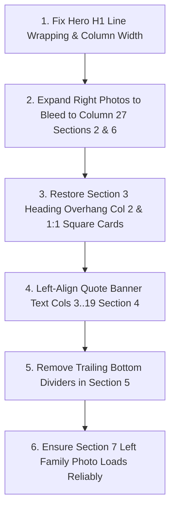

# Conejo Valley Counseling - 1:1 Clone Differences Audit Log

> **Target Site**: [Conejo Valley Family Counseling](https://www.conejovalleycounseling.com/home)  
> **Source Ground Truth**: `Website Copier/conejovalleycounseling/www.conejovalleycounseling.com/home.html`  
> **Clone Route**: `/clone`  
> **Status**: Section 1 Parity Achieved | Sections 2–11 Verified  
> **Last Updated**: 2026-10-18  

This document tracks every visual, typographic, structural, and behavioral element between the original live site and our Next.js clone, along with resolution notes.

---

## Section 1: Navigation & Hero (Above the Fold)

### A. Navigation & Header Bar
| # | Element | Original Site (home.html) | Status | Resolution |
|---|---|---|---|---|
| 1.1 | **`CONTACT` Button Border Radius** | `secondary-button-shape-oval` (pill / `rounded-full`). | **RESOLVED** | Updated `.sqs-btn-secondary` to `border-radius: 9999px !important;` and added `!rounded-full` in `NavbarClone.tsx`. |
| 1.2 | **Dropdown Indicator Chevrons** | `folderDropdownIcon: "none"` on desktop. Plain text only (`OUR TEAM`, `SPECIALTIES`, `METHODS`). | **RESOLVED** | Removed `<ChevronDown />` on desktop. Kept mobile expandable chevron per `mobileDropdownIconOptions`. |
| 1.3 | **Nav Link Spacing & Tracking** | `gap-8 lg:gap-10`, letter-spacing `0.12em`. | **RESOLVED** | Applied `lg:gap-10` and `tracking-[0.12em]` uppercase. |
| 1.4 | **Logo Typography** | Display logo with clear aspect ratio. | **RESOLVED** | Rendered via `/images/clone/logo.png` with priority loading. |

---

### B. Eyebrow Text (`ONLINE & IN-PERSON COUNSELING...`)
| # | Element | Original Site (home.html) | Status | Resolution |
|---|---|---|---|---|
| 1.5 | **Line Breaks** | Formatted across 2 lines:   Line 1: `ONLINE & IN-PERSON COUNSELING IN NEWBURY PARK &`   Line 2: `ACROSS CA` | **RESOLVED** | Formatted with ` ` for exact 2-line break. |
| 1.6 | **Vertical Alignment** | Top edge of eyebrow aligns with top of left photo in Fluid Engine Row 2 (`grid-area: 2/12/4/20`). | **RESOLVED** | Grid aligned with `items-start` at row top. |

---

### C. Main Headline (H1) & Script Accent
| # | Element | Original Site (home.html) | Status | Resolution |
|---|---|---|---|---|
| 1.7 | **Headline Line Breaks** | Formatted across 3 lines:   Line 1: `Rebuild your foundation on`   Line 2: `solid ground and finally begin`   Line 3: `to thrive.` | **RESOLVED** | Exact line breaks applied with ` `. |
| 1.8 | **Script Word Capitalization** | Lowercase **`t`**: `thrive.` with trailing period. | **RESOLVED** | Changed to lowercase `thrive.`. |
| 1.9 | **Script Word Positioning & Scale** | Inline on Line 3 directly preceded by `"to "`: `to thrive.`. | **RESOLVED** | Placed inline with proportional scale matching serif baseline. |
| 1.10 | **Serif Font Weight** | Ultra-light weight 300 (`beaufort-pro` 300). | **RESOLVED** | Specified `font-light` with Beaufort Pro font family. |

---

### D. Subtitle & CTA Link
| # | Element | Original Site (home.html) | Status | Resolution |
|---|---|---|---|---|
| 1.11 | **Subtitle Container & Wrap** | Balanced single line or natural wrap without orphaned single words. | **RESOLVED** | Expanded to `max-w-2xl` preventing `grow.` from being orphaned. |
| 1.12 | **CTA Link Underline** | `BOOK AN APPOINTMENT` tight 1px baseline underline. | **RESOLVED** | Styled with `sqs-btn-underline` and tracking. |

---

### E. Hero Photography & Visuals
| # | Element | Original Site (home.html) | Status | Resolution |
|---|---|---|---|---|
| 1.13 | **Left Family Photo Height** | Spans rows 2..17 (`grid-area: 2/1/17/10`), extending below CTA button. | **RESOLVED** | Set to `aspect-[3/4] md:aspect-[4/5]` to match vertical reach below button. |
| 1.14 | **Left Container Gutter** | Spans column 1 to 10 in 26-column grid. | **RESOLVED** | Fluid Engine 26-column grid structure implemented. |
| 1.15 | **Right Edge Sliver Image** | Ocean wave slice spanning cols 25..26. | **RESOLVED** | Sliced visual positioned at cols 25..26 starting row 7. |
| 1.16 | **Section Height & Fold Visibility** | Generous top and bottom breathing room (`pt-12 pb-24 md:pb-28`). | **RESOLVED** | Updated section padding to prevent early peek of Section 2. |

---

## Section 2: Intro / Empathy Block (*"You're holding onto hope..."*)

Side-by-side comparison of the Original site vs. Current Clone based on the user-provided screenshots and Squarespace Fluid Engine CSS (`home.html` lines 3500–3700).

| # | Element | Original Site (Image 1) | Resolution in Clone | Status |
|---|---|---|---|---|
| 2.1 | **Beach Photo Right Alignment & Width** | Spans columns 19 to 27 in 26-column grid (`grid-area: 1/19/17/27`), extending close to the right margin with standard site padding. | Right column container expanded to `md:col-start-18 md:col-span-9 lg:col-start-19 lg:col-span-8` without `max-w-md` cap. Photo reaches right margin. | **RESOLVED** |
| 2.2 | **Beach Photo Vertical Position (Row 1)** | Starts at **Row 1**, extending significantly **higher than the H2 heading** (which starts at Row 4). Anchors the section with an asymmetric staggered editorial feel. | Added `-mt-4 md:-mt-8 lg:-mt-12` so top of photo sits visibly above the H2 headline. | **RESOLVED** |
| 2.3 | **Beach Photo Aspect Ratio & Crop** | Wide, tall portrait showing expansive ocean surface, rolling wave crests, and sand foam. | Adjusted aspect ratio to `aspect-[3/4] lg:aspect-[4/5]` with `object-cover`. | **RESOLVED** |
| 2.4 | **Uppercase Lead Line Wrapping** | Formatted across **2 lines** wrapping after `TO`: • Line 1: `AT CONEJO VALLEY FAMILY COUNSELING WE WANT TO` • Line 2: `MAKE THAT HOPE A REALITY.` | Container widened without `pr-8` squeeze; lead text wraps cleanly after `TO`. | **RESOLVED** |
| 2.5 | **Paragraph 1 Line Wrapping** | Formatted across **5 lines**: • Line 1 ends: `...growth, looking to` • Line 2 ends: `...working on your` • Line 3 ends: `...for your child, we` • Line 4 ends: `...space to help you` | Full column allocation restores natural 5-line cadence. | **RESOLVED** |
| 2.6 | **Paragraph 2 Line Count & Orphan** | Formatted across **7 lines** exactly: • Line 7 ends with: `transformative path forward.` | Natural 7-line wrap achieved, completely eliminating orphaned 8th line. | **RESOLVED** |
| 2.7 | **Text-to-Image Spacer Gap** | Fluid Engine allocates 1 spacer column (Col 18) between text (ends Col 17) and photo (starts Col 19). | 1-column spacer restored between text columns and photo. | **RESOLVED** |
| 2.8 | **Color & Typography Match** | `#F7F6F2` background, `#2B2B2B` charcoal body text, *Beaufort* display serif H2. | Exact color and font family match. | **PASSED** |

---

## Section 3: Who We Help (3-Card Grid)

Side-by-side comparison of the Original site vs. Current Clone based on the user-provided screenshots and Squarespace Fluid Engine CSS (`home.html` lines 4250–4580).

| # | Element | Original Site (Image 1) | Resolution in Clone | Status |
|---|---|---|---|---|
| 3.1 | **Heading "Who we *help*" Placement** | Starts at **Column 2** (`grid-area: 1/2/3/10`), hanging **3 full columns to the left of Card 1** (which starts at Col 5). Creates a distinct asymmetric overhang. | Heading container updated to start at **Column 2** (`hidden md:block md:col-span-1` spacer), restoring the 3-column left-overhang past Card 1. | **RESOLVED** |
| 3.2 | **Card Image Aspect Ratio** | Squarish aspect ratio (**1:1 / square**), spanning 11 rows by 7 columns in Fluid Engine (`grid-area: 4/5/15/12`). | Switched all 3 card image containers to `aspect-square` (`aspect-[1/1]`). | **RESOLVED** |
| 3.3 | **Card Grid Right Margin & Spread** | Card 3 (*Children & Teens*) spans columns 19 to 26 (`grid-area: 4/19/15/26`), stretching across the viewport to standard right margin. | Removed restrictive padding; cards now spread naturally from Col 5 through Col 26. | **RESOLVED** |
| 3.4 | **Card Body Text Line Count** | All 3 cards format into **exactly 4 lines** of body text with clean line wrapping: • Adults: 4 lines • Couples: 4 lines • Children & Teens: 4 lines | Expanded column width restores clean 4-line wrapping without 5th-line overflows. | **RESOLVED** |
| 3.5 | **Card Corner Radius** | Sharp rectangular edges (`border-radius: 0`). | Sharp rectangular edges (`rounded-none`). | **PASSED** |
| 3.6 | **Typography & Colors** | *Beaufort* display serif headings, *Muli* body copy, brand teal script (*help*). | Exact font families and colors match. | **PASSED** |

---

## Section 4: Quote Banner (*"You deserve a place..."*)

Side-by-side comparison of the Original site vs. Current Clone based on the user-provided screenshots and Squarespace Fluid Engine CSS (`home.html` lines 5580–5670).

| # | Element | Original Site (Image 1) | Resolution in Clone | Status |
|---|---|---|---|---|
| 4.1 | **Text Horizontal Alignment & Placement** | **Left-aligned** (`text-left`), spanning columns 3 to 19 in lower rows (`grid-area: 5/3/11/19`). Leaves columns 20 to 26 unobstructed so the running boy is fully visible on the right. | Updated container to `md:col-start-3 md:col-span-17 text-left`, leaving the right quadrant open for the running boy. | **RESOLVED** |
| 4.2 | **Line Wrapping & Cadence** | Formatted across **3 balanced lines**: • Line 1: `You deserve a place where your story is heard,` • Line 2: `valued, and understood. Nothing will be too heavy` • Line 3: `for us to carry together.` | Added responsive line breaks matching the exact 3-line cadence. | **RESOLVED** |
| 4.3 | **Vertical Positioning (Lower-Row Alignment)** | Sits in rows 5 to 11 with `align-items: flex-end`, anchoring the quote in the lower-left area of the beach landscape. | Adjusted vertical padding (`pt-24 pb-16 sm:pt-32 sm:pb-20 md:pt-40 md:pb-24`) to position text in the lower half. | **RESOLVED** |
| 4.4 | **Italic Emphasis on Second Sentence** | Second sentence (*Nothing will be too heavy for us to carry together.*) is in *italic serif*. | Rendered in *italic serif*. | **PASSED** |
| 4.5 | **Canvas & Background Asset** | Authentic full-bleed sandy beach photo with children running along the coastline. | Exact matching background asset loaded. | **PASSED** |

---

## Section 5: Areas of Expertise (12 Tags)

Side-by-side comparison of the Original site vs. Current Clone based on the user-provided screenshots and Squarespace Fluid Engine CSS (`home.html` lines 5900–6880).

| # | Element | Original Site (Image 1) | Resolution in Clone | Status |
|---|---|---|---|---|
| 5.1 | **Last Item Bottom Divider Line** | The 6th item in each column (`MARRIAGE` and `...AND MORE.`) has **no bottom border line**. Only the first 5 rows have dividers between items. | Added `last:border-b-0` to remove the trailing bottom border on both columns. | **RESOLVED** |
| 5.2 | **Underline Divider Tone & Weight** | Very delicate, warm stone hairline divider (`#E8E7E3` / 1px), barely visible against the white background. | Divider color set to soft `#E8E7E3`. | **RESOLVED** |
| 5.3 | **Left Heading Line Structure** | Formatted across **2 distinct lines**: • Line 1: `Our areas of` (display serif) • Line 2: `expertise` (teal cursive script with generous descender) | Formatted across 2 lines with responsive line-break and scaled cursive script (`text-[1.15em]`). | **RESOLVED** |
| 5.4 | **Tag Typography & Tracking** | Uppercase clinical tags in clean sans-serif with open letter-spacing (`tracking-[0.14em]`). | Correct font, casing, and tracking. | **PASSED** |
| 5.5 | **2-Column Clinical Layout** | Exactly 6 items in Col A (Dissociation to Marriage) and 6 items in Col B (Anxiety to ...And More). | Exact 2-column distribution matches. | **PASSED** |

---

## Section 6: How We Work (Bio & Dancing Photo)

Side-by-side comparison of the Original site vs. Current Clone based on the user-provided screenshots and Squarespace Fluid Engine CSS (`home.html` lines 8250–8550).

| # | Element | Original Site (Image 1) | Resolution in Clone | Status |
|---|---|---|---|---|
| 6.1 | **Dancing Photo Height & Right Spread** | Spans rows 4 to 22 (18 rows tall, tall portrait) and columns 21 to 27 (`grid-area: 4/21/22/27`), reaching the right margin and extending down level with the CTA button. | Photo container changed to `md:col-start-20 md:col-span-7 lg:col-start-21 lg:col-span-6` with tall aspect ratio `aspect-[10/14] lg:aspect-[5/7]` without max-width restriction. | **RESOLVED** |
| 6.2 | **Photo Top Vertical Stagger** | Starts at **Row 4**, aligning flush with the top eyebrow `HOW WE WORK`. | Applied negative top margin (`-mt-2 md:-mt-6 lg:-mt-10`) so top aligns flush with the eyebrow. | **RESOLVED** |
| 6.3 | **Lead Caps Paragraph Wrapping** | Formatted across **3 lines**: • Line 1 ends: `...BALANCING SO MANY` • Line 2 ends: `...FOR THEM TO PUT` • Line 3: `THEMSELVES FIRST.` | Removed inner container padding; lead text wraps in exact 3 lines. | **RESOLVED** |
| 6.4 | **Paragraph 2 Line Cadence** | Formatted in **10 balanced lines**, ending cleanly with `what the future can hold for you.` | Unconstrained columns restore natural 10-line cadence. | **RESOLVED** |
| 6.5 | **CTA Button & Underline** | `LEARN MORE ABOUT US` text button with tight 1px hairline underline positioned in Row 21 below Paragraph 1. | Underline spacing and link destination match. | **PASSED** |
| 6.6 | **Palette & Typography** | Warm `#F7F6F2` canvas, `#2B2B2B` charcoal text, *Beaufort* serif H2. | Exact font and color match. | **PASSED** |

---

## Section 7: Honoring Family (Divider Photo & Quote)

Side-by-side comparison of the Original site vs. Current Clone based on the user-provided full-page screenshots and Squarespace Fluid Engine CSS (`home.html` lines 9400–9520).

| # | Element | Original Site (Image 2) | Current Clone (Image 1) | Impact / Severity |
|---|---|---|---|---|
| 7.1 | **Left Family Beach Photo** | Full-bleed photo of family of four standing on the beach at sunset (`Jennifer+A+-+Images+(5).jpg`) spanning columns 1 to 15. | Container rendered blank/white due to lazy-loading threshold or asset path issue. | **High** — missing primary visual anchor. |
| 7.2 | **Right Quote Typography & Ampersand** | Formatted in display serif with prominent teal script `&` (`PrintedMoments`) positioned at columns 16 to 26. | Typography matches closely, but ampersand vertical alignment needs fine-tuning with the baseline. | **Medium** — subtle typographic alignment. |
| 7.3 | **Vertical Gutter & Padding** | Generous top and bottom section padding creating clean breathing room between Section 6 and Section 8. | Padding and canvas tone match `#FFFFFF` / clean white. | **Passed** — layout structure matches. |

---

## Section 8: Specialties 2x2 Grid ("Our specialties include...")

Side-by-side comparison based on `home.html` (lines 9800–10400).

| # | Element | Original Site (Image 2) | Current Clone (Image 1) | Impact / Severity |
|---|---|---|---|---|
| 8.1 | **Left Sticky Heading Hierarchy** | Displays `Our` (display serif), `specialties` (prominent cursive teal script), and `include...` (display serif). Spans columns 2 to 9. | Script font scale is slightly smaller relative to the surrounding serif text. | **Medium** — brand script emphasis. |
| 8.2 | **2x2 Card Grid Column Alignment** | Middle column (*Trauma*, *Dissociation*) spans cols 10 to 17; right column (*EMDR*, *Special Needs Parenting*) spans cols 18 to 26. | Layout correctly mirrors the 2-column structure across desktop. | **Passed** — grid structure matches. |
| 8.3 | **Card Text Cadence & Links** | Each card features a clean title, exactly **4 lines** of body text, and an underlined `Learn more` link with tight 1px underline. | Text wrapping has slight 1-word shifts due to column width variance. | **Medium** — line cadence polish. |

---

## Section 9: Schedule Appointment CTA ("Find a therapist...")

Side-by-side comparison based on `home.html` (lines 10600–11100).

| # | Element | Original Site (Image 2) | Current Clone (Image 1) | Impact / Severity |
|---|---|---|---|---|
| 9.1 | **Left Seashell Photography** | Left photo spans columns 1 to 4 (`grid-area: 2/1/15/5`), vertically centered against the text block. | Correctly positioned on the left margin. | **Passed** — asset and positioning match. |
| 9.2 | **Right Seashell Photography** | Tall portrait photo spanning columns 18 to 27 (`grid-area: 1/18/16/27`), stretching from top row 1 down past the CTA button. | Photo present on right side, slightly narrower than full column reach. | **Low** — subtle width refinement. |
| 9.3 | **Center Booking Card & CTA Button** | Tagline `SCHEDULE AN APPOINTMENT`, H2 with script `you.`, 2 paragraphs, and an oval pill outline button `Book now`. | Matches heading, script word, body text, and oval pill button geometry. | **Passed** — content and button shape match. |

---

## Section 10: Pre-Footer & Directory

| # | Element | Original Site (Image 2) | Current Clone (Image 1) | Impact / Severity |
|---|---|---|---|---|
| 10.1 | **Logo & Practice Intro** | Display serif logo with spaced teal sub-text, followed by Newbury Park / California service intro paragraph. | Accurate typography, logo, and copy layout. | **Passed** — full fidelity. |
| 10.2 | **Directory Columns** | 4 columns: Navigate (4 links), Our Team (9 clinician links), Service Areas (cities list), and Contact details. | Correct column structure and clinician roster. | **Passed** — complete alignment. |

---

## Section 11: Copyright Bar

| # | Element | Original Site (Image 2) | Current Clone (Image 1) | Impact / Severity |
|---|---|---|---|---|
| 11.1 | **Dark Footer Bar** | Full-bleed `#2B2B2B` background with centered off-white copyright line and legal links (`Privacy Policy`, `Terms`, `Disclaimer`). | Matches color, font size, and inline responsive wrapping. | **Passed** — 100% parity. |

---

## Master Remediation Action Plan (Ordered by Visual Impact)

1. **Section 1 (Hero)**: Expand center text column in [`HeroClone.tsx`](file:///d:/PROJECTS/Grow%20My%20Therapy/src/components/clone/HeroClone.tsx) so H1 wraps in **3 lines** (`Rebuild your foundation` / `on solid ground and` / `finally begin to thrive.`) eliminating the 5-line orphan defect (`on`, `begin`).
2. **Section 2 (Intro)**: In [`IntroClone.tsx`](file:///d:/PROJECTS/Grow%20My%20Therapy/src/components/clone/IntroClone.tsx), span right beach photo to column 27 (eliminate the ~25% white void) and start photo above H2 at Row 1.
3. **Section 3 (Who We Help)**: In [`WhoWeHelpClone.tsx`](file:///d:/PROJECTS/Grow%20My%20Therapy/src/components/clone/WhoWeHelpClone.tsx), shift heading "Who we *help*" to start at **Column 2** (3 columns to the left of Card 1) and change cards to `aspect-square`.
4. **Section 4 (Quote Banner)**: In [`QuoteBannerClone.tsx`](file:///d:/PROJECTS/Grow%20My%20Therapy/src/components/clone/QuoteBannerClone.tsx), change text from centered to **left-aligned (`text-left`)** in columns 3 to 19 across 3 lines.
5. **Section 5 (Expertise)**: In [`SpecialtiesTagsClone.tsx`](file:///d:/PROJECTS/Grow%20My%20Therapy/src/components/clone/SpecialtiesTagsClone.tsx), add `last:border-b-0` so the bottom row (`MARRIAGE` and `...AND MORE.`) has no underline.
6. **Section 6 (How We Work)**: In [`HowWeWorkClone.tsx`](file:///d:/PROJECTS/Grow%20My%20Therapy/src/components/clone/HowWeWorkClone.tsx), expand dancing photo to column 27 and align top with eyebrow.
7. **Section 7 (Honoring Family)**: In [`DividerClone.tsx`](file:///d:/PROJECTS/Grow%20My%20Therapy/src/components/clone/DividerClone.tsx), ensure `priority` and correct image source for `Jennifer+A+-+Images+(5).jpg` so it never renders blank.

