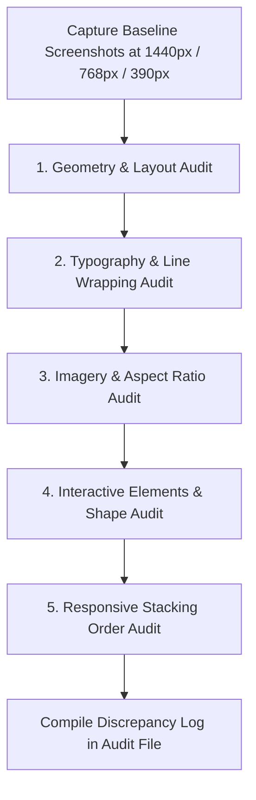

# Standard Operating Protocol: 1:1 Website Clone Parity & Remediation

> **Document**: `CLONE_PARITY_PROTOCOL.md`  
> **Purpose**: Standardized engineering methodology for detecting visual, typographic, structural, and responsive discrepancies between an original live website and a front-end clone, followed by systematic remediation to achieve 100% pixel-accurate replication.

---

## 1. Core Principles of 1:1 Cloning

When replicating a live website (e.g., Squarespace, Webflow, WordPress, or custom builds) in Next.js + Tailwind CSS:
1. **Never Assume — Always Measure**: What looks like "centered text" might be an asymmetric column grid with an empty spacer column. What looks like a generic serif is usually a specific webfont with tailored tracking and line-height.
2. **The Viewport Triad**: A clone is only 1:1 if it matches across **Desktop (1440px)**, **Tablet (768px)**, and **Mobile (390px)**.
3. **Typography is 70% of Brand Identity**: Line breaks, orphan words, letter-spacing (`tracking`), script font scale, and baseline alignment dictate whether a clone feels authentic or like a rough copy.

---

## 2. Phase 1: Difference Detection Protocol (Audit Phase)

Follow this 5-point audit checklist for every section:



### 1. Geometry & Layout Audit
- **Grid Structure**: Determine whether the original uses CSS Grid, Flexbox, or Fluid Engine columns (e.g., Squarespace 24-column grid).
- **Alignment Planes**: Check horizontal alignment lines. Does the eyebrow text align with the top of the photo? Does the headline align with row 7?
- **Section Fold Height**: Compare vertical padding (`py-`) and how much content is visible above the 900px fold. If Section 2 is creeping into the hero fold on the clone, the hero padding or height is too small.
- **Gutters & Margins**: Check container `max-width` and horizontal padding (`px-`).

### 2. Typography & Line-Break Audit
- **Exact Line Breaks**: Note where lines break. If the original breaks at *"Rebuild your foundation on"*, the clone must break at the exact same word, not push *"solid"* onto the first line.
- **Capitalization**: Verify case-sensitivity (e.g., lowercase `thrive.` vs capitalized `Thrive.`).
- **Script & Accent Words**: Check the font family, font weight, relative font size (`em` vs `rem`), baseline alignment, and whether punctuation (periods, commas) is included inside the script span.
- **Orphan Words**: Look for single words wrapping onto a line alone (e.g., `grow.` on line 2). If the original doesn't have orphans, expand the container max-width or balance with CSS.
- **Letter Spacing & Line Height**: Check `letter-spacing` (Tailwind `tracking-wider`, `tracking-widest`, or custom rem) and `line-height` (`leading-tight`, `leading-[1.14]`).

### 3. Imagery & Aspect Ratio Audit
- **Orientation & Dimensions**: Compare aspect ratio (`aspect-[3/4]` portrait vs `aspect-[16/11]` landscape).
- **Vertical Reach**: Check where the bottom of an image sits relative to adjacent text/buttons (e.g., does the photo extend past the button down to the section bottom?).
- **Asset Correctness**: Verify that the exact same photo is used, not a placeholder or adjacent photo from the same photoshoot.
- **Corners & Shadows**: Ensure `rounded-none` and `shadow-none` if the original features sharp, flat editorial photography.

### 4. Interactive Elements & Micro-Styling Audit
- **Button Shapes**: Check `border-radius`. Is the button a sharp rectangle (`rounded-none`), soft curve (`rounded-md`), or pill/oval (`rounded-full`)?
- **Underlines**: Check if links have static borders or animated pseudo-elements (`::before`/`::after`). Note vertical offset from the text.
- **Unnecessary Elements**: Check for extra icons (like dropdown chevrons) that do not exist on the original site.

### 5. Responsive Stacking Order Audit
- **Mobile Reordering**: On mobile (< 768px), original sites often reorder blocks (e.g., text above image, or beach photo inserted between Paragraph 1 and Paragraph 2). Check if the clone preserves this exact sequence.
- **Tablet Threshold**: Check at what screen width the multi-column layout activates. In Squarespace, it activates at `768px` (`md:` in Tailwind), not `1024px` (`lg:`).

---

## 3. Phase 2: Systematic Remediation Protocol (Fix Phase)

When fixing discrepancies, proceed in this exact sequence to avoid circular regressions:

### Step 1: Fix Structure, Containers & Breakpoints First
- Set the correct grid template (e.g., `grid grid-cols-1 md:grid-cols-26`).
- Ensure breakpoints match the original engine: use `md:` (768px) for desktop grid activation rather than `lg:` (1024px).
- Set container `max-w-[1500px]` with generous vertical padding (`py-20 md:py-28`).

### Step 2: Enforce Exact Line Breaks & Typography
- **Controlled Wrapping**: To achieve the identical line break of the original without breaking responsiveness:
  - Use deliberate `<br className="hidden md:inline" />` tags or tailored `max-w-[...]` constraints.
  - Example:
    ```tsx
    {/* Exact 3-line wrap matching original */}
    <h1 className="font-beaufort text-3xl sm:text-4xl md:text-[52px] font-light leading-[1.14]">
      Rebuild your foundation on<br className="hidden md:inline" />{" "}
      solid ground and finally begin<br className="hidden md:inline" />{" "}
      to <span className="script-word">thrive.</span>
    </h1>
    ```
- **Script Font Alignment**: Ensure the script word is lowercase (`thrive.`), shares the baseline with `to `, and has proportional sizing (`text-[1.15em]` or `text-[1.2em]`).
- **CSS Specificity**: Ensure custom font classes or color overrides have sufficient specificity (e.g., `.clone-page .quote-banner h2 { color: #F7F6F2 !important; }`) so general rules don't overwrite them.

### Step 3: Align Image Proportions & Slices
- Replace squarish aspect ratios with authentic tall portrait aspect ratios (e.g., `aspect-[4/5]` or `aspect-[10/14]` instead of `aspect-[1365/1246]`).
- For slice slivers on the right margin: align top position with the headline baseline using `pt-8 md:pt-14`.

### Step 4: Correct Component Shapes & Details
- Replace sharp button boxes with `rounded-full` where the original uses pill buttons:
  ```tsx
  {/* Original Contact CTA: Pill outline button */}
  <Link href="/clone#contact" className="rounded-full border border-[#2B2B2B] px-6 py-2 text-xs tracking-widest uppercase hover:bg-[#2B2B2B] hover:text-white transition-colors">
    Contact
  </Link>
  ```
- Remove any unprompted icons (e.g., delete `<ChevronDown />` from plain navigation links).

### Step 5: Implement Mobile Order Classes
- Use Flexbox/Grid ordering to achieve identical mobile block flow:
  - Text: `order-1 md:order-3`
  - Image: `order-2 md:order-1`
- Use dual rendering for elements inserted between paragraphs on mobile:
  - Mobile only: `<div className="block md:hidden my-6">...</div>`
  - Desktop only: `<div className="hidden md:flex">...</div>`

---

## 4. Phase 3: Automated Verification Protocol

After applying any fix:
1. **Compilation Check**: Run `npm run build` to verify 0 TypeScript and compiler errors.
2. **Automated Capture**: Run the headless Puppeteer script (`node scratch/capture_screens.js`) to capture fresh PNGs at:
   - Desktop: `1440 x 900`
   - Tablet: `768 x 1024`
   - Mobile: `390 x 844`
3. **Side-by-Side Validation**: Compare `clone_*_full.png` against `real_*_full.png`.
4. **Update Audit Log**: Check off completed items in `CLONE_DIFFERENCES_AUDIT.md`.
