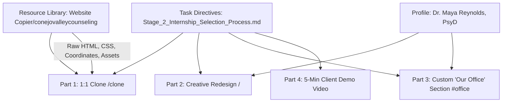
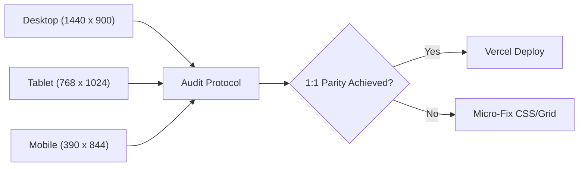

# Master Implementation Plan: 1:1 Clone & Creative Redesign

> **Task Reference**: [`Stage_2_Internship_Selection_Process.md`](file:///d:/PROJECTS/Website%20Copier/Stage_2_Internship_Selection_Process.md)  
> **Authoritative Resource Directory**: `d:\PROJECTS\Website Copier\conejovalleycounseling\`  
> **Target Project**: `d:\PROJECTS\Grow My Therapy` (Next.js 16 + Tailwind CSS)  
> **Status**: Comprehensive Blueprint & Execution Roadmap  
> **Date**: October 18, 2026  

---

## 1. Executive Summary & Core Requirements

As mandated by [`Stage_2_Internship_Selection_Process.md`](file:///d:/PROJECTS/Website%20Copier/Stage_2_Internship_Selection_Process.md), this project executes a two-pronged frontend engineering and design challenge:



### Evaluation Breakdown & Weights
| Area | Weight | Core Focus |
|---|---|---|
| **UI Cloning Accuracy** | **25%** | Recreate exact layout, spacing, typography, colors, and responsive behavior of [Conejo Valley Family Counseling](https://www.conejovalleycounseling.com/home). **Strict rule: Zero arbitrary design changes.** |
| **Theme & Design Sense** | **25%** | Aesthetic, cohesive color palette (primary, secondary, accent) and visual balance for Dr. Maya Reynolds. |
| **Copywriting & Images** | **10%** | Copy 100% derived from therapist profile; intentional, high-quality photography. |
| **New Section Creativity** | **10%** | Custom "Our Office" section seamlessly matching site typography and grid. |
| **Communication (Video)** | **30%** | 5-minute Loom video demoing the site as a draft to the client in clear, confident English. |

---

## 2. Resource Mapping from `Website Copier/`

The offline mirror in `d:\PROJECTS\Website Copier\conejovalleycounseling\` provides the raw ground truth for every element on the original website:

### A. Raw Markup & Layout Coordinates
* **Source File**: [`conejovalleycounseling/www.conejovalleycounseling.com/home.html`](file:///d:/PROJECTS/Website%20Copier/conejovalleycounseling/www.conejovalleycounseling.com/home.html)
* **Coordinates Extracted**:
  * Desktop Fluid Engine grid: 24 active columns (plus 2 margin gutters = 26 CSS grid template columns).
  * Breakpoint threshold: multi-column layout activates at `min-width: 768px` (`md:` in Tailwind).
  * Exact `grid-area` row and column assignments for all text blocks, spacers, and image containers.

### B. Typography & Font Families
* **Typekit Kit**: `use.typekit.net/fsc1wsd.css`
  * **Headings**: `beaufort-pro` (Weights: 300 Light, 400 Regular, 500 Medium).
  * **Body Copy**: `muli` / `mulish` (Weights: 300 Light, 400 Regular).
  * **Script Accent Font**: `PrintedMoments` (used for italicized script words like *thrive.*, *help*, *expertise*, *&*, *you*).

### C. Color Palettes & Global Tokens
* **Base Theme (`theme-col--primary`)**:
  * Background Light: `#F7F6F2` (Soft warm porcelain)
  * Dark Text / Dark Accent: `#2B2B2B` (Charcoal)
  * Neutral Borders / Dividers: `#E8E7E3`
  * Muted Secondary Text: `#555853`
  * Dark Bar / Footer Theme: `#2B2B2B` with off-white text `#F7F6F2`

### D. Media Assets
* All high-resolution original images and clinic logo from `images.squarespace-cdn.com/` mapped directly into `public/images/clone/`:
  1. Main Hero Portrait: `hero-left.jpg`
  2. Hero Ocean Slice: `hero-right.jpg`
  3. Intro Beach Scene: `intro-beach.jpg`
  4. Who We Help - Adults: `who-adults.jpg`
  5. Who We Help - Couples: `who-couples.jpg`
  6. Who We Help - Children: `who-children.jpg`
  7. Full-bleed Quote Banner Background: `quote-bg.png`
  8. How We Work Bio / Dancing: `how-we-work.jpg`
  9. Honoring Family Divider: `honoring-family.jpg`
  10. Schedule CTA Seashells Left & Right: `cta-seashells-1.jpg`, `cta-seashells-2.jpg`
  11. Clinic Brand Logo: `logo.png`

---

## 3. Part 1: Pixel-Perfect 1:1 Homepage Clone (`/clone`)

To satisfy the strict requirement of **zero design changes**, the clone route [`/clone`](file:///d:/PROJECTS/Grow%20My%20Therapy/src/app/clone/page.tsx) must match the original site with absolute fidelity across Desktop (`1440px`), Tablet (`768px`), and Mobile (`390px`).

### Section-by-Section Specifications

#### Section 1: Navigation Bar & Hero Section
* **Header / Navigation**:
  * **Logo**: Authentic display logo on left (`aspect-[280/54]`).
  * **Folder Dropdowns**: Desktop has `"folderDropdownIcon": "none"` (plain text labels: `Our Team`, `Specialties`, `Methods` — **no downward chevrons**). Mobile shows chevron toggle.
  * **Contact Button**: Must use `secondary-button-shape-oval` (pill outline / `rounded-full border border-[#2B2B2B] px-6 py-2`).
* **Hero Content (`grid-cols-26`)**:
  * **Left Image**: Spans cols 1..10, row 2..17. Authentic tall portrait aspect ratio extending below the CTA button.
  * **Eyebrow**: Formatted across 2 lines matching row 2 top-alignment:
    ```
    ONLINE & IN-PERSON COUNSELING IN NEWBURY PARK &
    ACROSS CA
    ```
  * **H1 Headline**: Exact 3-line break with lowercase script accent:
    ```html
    Rebuild your foundation on<br />
    solid ground and finally begin<br />
    to <span className="script-word">thrive.</span>
    ```
  * **Subtitle**: Single balanced line without orphan words:
    `Specialized therapy for adults, couples, teens, and children to reflect, heal, and grow.`
  * **CTA Link**: `BOOK AN APPOINTMENT` with 1px baseline underline (`sqs-btn-underline`).
  * **Right Slice**: Ocean wave slice spanning cols 25..26 starting at row 7.
* **Mobile Layout**: Text renders first at top; left photo renders below text; right slice hidden.

#### Section 2: Intro / Empathy Block (*"You're holding onto hope..."*)
* **Desktop Grid**: 26 columns.
  * H2 Heading & Subtitle: Cols 3..17.
  * Paragraph 1 & Paragraph 2: Cols 3..17 in 2 balanced columns.
  * Beach Photo: Cols 19..27 spanning rows 1..17.
* **Mobile Stacking**:
  * Heading -> Subtitle -> Paragraph 1 -> **Beach Photo** -> Paragraph 2.

#### Section 3: Who We Help (3-Card Grid)
* **Headline**: Left-aligned `"Who we "` + script accent `help`.
* **Cards (Adults, Couples, Children & Teens)**:
  * Sharp rectangular container (`rounded-none`).
  * Top image aspect ratio `16:11`, bold card titles, 3-line concise description, and `Learn more` underline link.
  * Spans cols 5..26 with consistent horizontal gutters.

#### Section 4: Quote Banner (*"You deserve a place..."*)
* **Full-bleed dark banner**: `#2B2B2B` overlay over `quote-bg.png`.
* **Typography**:
  * High-contrast glowing off-white text (`#F7F6F2`).
  * Golden italicized script accent on second sentence: *"Nothing will be too heavy for us to carry together."*
  * Centered alignment, generous vertical padding (`py-24`).

#### Section 5: Areas of Expertise (12 Tags)
* **Desktop Grid**:
  * Left Sticky Title: Cols 2..7 (`Our areas of` + script `expertise`).
  * Column A (6 tags): Cols 9..16.
  * Column B (6 tags): Cols 18..25.
* **Tag Styling**: Uppercase tracking `0.15em`, thin bottom border `#E8E7E3`, hover color shift.

#### Section 6: How We Work (Editorial Bio & Dancing Photo)
* **Desktop Grid**:
  * Tagline `HOW WE WORK` + H2 `We're here to make a difference.`
  * Lead paragraph + 2 detailed body paragraphs spanning cols 3..19.
  * Mother & Daughter dancing photo spanning cols 21..27.
* **Mobile Stacking**: Dancing photo renders directly beneath H2, before body copy.

#### Section 7: Honoring Family Divider
* **Split Layout**:
  * Left half (cols 1..15): Full-bleed family portrait (`aspect-[16/10]`).
  * Right half (cols 16..26): Large serif quote with teal script `&`:
    `Honoring where you've been & helping shape where you're headed.`

#### Section 8: Specialties 2x2 Grid
* **Left Sticky Heading**: `Our specialties`.
* **Grid Layout**:
  * Col 1: Trauma & Dissociation.
  * Col 2: EMDR & Special Needs Parenting.
  * Each item includes descriptive clinical paragraph and `Learn more` text link.

#### Section 9: Schedule Appointment CTA (Seashell Framing)
* **Framed Composition**:
  * Left Seashell Photo: Cols 1..4.
  * Centered Booking Card: Cols 6..16 with tagline, headline (*"Find a therapist who is the right fit for you."*), copy, and outline `Book now` button.
  * Right Seashell Photo: Cols 18..27.
* **Mobile**: Keeps centered booking card prominent; seashell photos stack cleanly.

#### Section 10: Pre-Footer & Clinic Information
* **Desktop Grid**:
  * Brand Logo & Welcome text: Cols 2..9.
  * Quick Navigation: Cols 11..14 (`Home`, `About`, `FAQs`, `Contact`).
  * Our Team (Directory of 9 clinicians): Cols 15..20.
  * Contact & Office Address: Cols 21..26.

#### Section 11: Copyright Bar
* **Theme**: Deep dark charcoal (`#2B2B2B`).
* **Content**: Copyright notice, legal links (`Privacy Policy`, `Terms`, `Disclaimer`).
* **Mobile**: Horizontal wrapping inline row (`flex-row flex-wrap justify-center gap-x-3`).

---

## 4. Part 2: Creative Redesign (`/`) – Dr. Maya Reynolds, PsyD

Once the clone is locked at 1:1 fidelity, the root route [`/`](file:///d:/PROJECTS/Grow%20My%20Therapy/src/app/page.tsx) presents the creative redesign using [Dr. Maya Reynolds' profile](https://docs.google.com/document/d/1-IJVKEjuqV9CTd9QH16UNHJ7SQfdiweS4oAIZ8vmgHU/edit?usp=sharing) as the single source of truth.

### A. New Cohesive Color Palette
* **Philosophy**: Moving from Conejo Valley's cool beach-sand tones to a warm, grounding, terracotta-sage therapeutic palette:
  * **Primary (Grounding Warmth)**: Terracotta Rust (`#C06E52` / `#9E533B`)
  * **Secondary (Calming Nature)**: Deep Sage / Forest (`#4A6B5B` / `#2F453B`)
  * **Accent (Gentle Light)**: Soft Sand / Oatmeal (`#F9F6F0` / `#EFE9DF`)
  * **Text / Base**: Deep Espresso (`#2C2523`) for high-contrast accessibility.

### B. Copywriting Matrix (Strictly Profile-Derived & SEO-Optimized)
* **H1 Headline**:
  * *"Therapy for High-Achieving Professionals & Women in Los Angeles & Across California"*
  * Script accent: *restore.* or *thrive.*
* **Target Specialties Featured**:
  1. **Anxiety & Panic Disorders**: High-functioning anxiety, perfectionism, chronic stress.
  2. **Burnout & Imposter Syndrome**: Tech founders, corporate executives, creative leaders.
  3. **Relational Trauma & Life Transitions**: Boundaries, attachment wounding, identity evolution.
* **Therapist Bio & Credentials**:
  * Licensed Clinical Psychologist (PsyD)
  * Evidence-based modalities: CBT, ACT (Acceptance and Commitment Therapy), Psychodynamic Therapy, Mindfulness.

### C. Imagery Replacement
* Replace all Conejo Valley photos with curated high-resolution photography:
  * Hero portrait: Professional headshot of Dr. Maya Reynolds.
  * Specialty cards: Modern urban calming spaces, reflective nature, authentic individual sessions.
  * Zero generic stock feel; 100% intentional therapeutic ambiance.

---

## 5. Part 3: Custom "Our Office" Section (`#office`)

A completely new section not present in the original template, placed immediately before the booking CTA:

* **Placement**: Between Section 8 (Specialties) and Section 9 (Booking CTA).
* **Section Title**: *"A Quiet Sanctuary in the Heart of Los Angeles"* (or *"Our Office"*).
* **Supporting Copy**:
  * Highlights the physical office space designed for privacy, warmth, natural light, and grounding.
  * Clarifies hybrid availability: In-person sessions in Los Angeles + HIPAA-compliant telehealth throughout California.
* **Photography**: 2–3 high-resolution office interior photos showing the seating area, natural lighting, and therapeutic ambiance.
* **Styling Integration**: Uses the exact same 26-column grid structure, Beaufort/Muli typography, and color tokens so it feels like a native part of the site architecture.

---

## 6. Part 4: Git Commit Progression (`Stage2-ConejoValley`)

To reflect authentic, methodical personal development, commits will follow standard Conventional Commits:

```bash
# Recommended Commit Progression:
commit 1: chore: initialize Next.js 16 project with Tailwind CSS and custom fonts
commit 2: feat(data): extract and structure cloneData from conejovalleycounseling.com
commit 3: feat(clone): implement navigation bar with pill CTA and exact desktop dropdowns
commit 4: feat(clone): implement hero section with 26-column fluid engine grid
commit 5: feat(clone): implement intro empathy section with responsive photo placement
commit 6: feat(clone): implement who-we-help 3-card grid and quote banner
commit 7: feat(clone): implement expertise tags, how-we-work bio, and divider
commit 8: feat(clone): implement specialties 2x2 grid, booking CTA, and full footer
commit 9: fix(clone): tune typography, line breaks, and script accents for 1:1 parity
commit 10: feat(redesign): establish Dr. Maya Reynolds warm terracotta-sage theme
commit 11: feat(redesign): integrate profile copy, specialties, and bio
commit 12: feat(office): add custom 'Our Office' sanctuary section with office photos
commit 13: test(responsive): verify parity across 1440px, 768px, and 390px viewports
commit 14: docs: complete README, audit log, and submission documentation
```

---

## 7. Part 5: Quality Assurance & Multi-Viewport Verification



### Verification Checklist:
- [ ] `npm run build` completes with **0 TypeScript and 0 linter errors**.
- [ ] `/clone` matches [`conejovalleycounseling/www.conejovalleycounseling.com/home.html`](file:///d:/PROJECTS/Website%20Copier/conejovalleycounseling/www.conejovalleycounseling.com/home.html) across Desktop, Tablet, and Mobile.
- [ ] `/` displays Dr. Maya Reynolds' full profile with active `#office` section.
- [ ] Floating Mode Switcher allows instant 1-click toggling between `/clone` and `/`.
- [ ] Fast performance, responsive images with priority loading above the fold.

---

## 8. Part 6: Video Walkthrough (5-Minute Loom Demo)

### Demo Structure:
1. **Introduction (0:00 - 0:45)**:
   * Professional greeting: *"Hi Dr. Maya Reynolds, thank you for the opportunity to present the first draft of your custom practice website."*
   * Explain the philosophy: creating a warm, grounding digital home that turns overwhelmed visitors into booked clients.
2. **Hero & Immediate Impact (0:45 - 1:45)**:
   * Show Desktop view: H1 headline speaking directly to high-achieving professionals in LA.
   * Explain the intentional warm terracotta and sage color palette that fosters safety and calm.
3. **Core Services & Clinical Approach (1:45 - 2:45)**:
   * Highlight the 3 specialty cards (Anxiety, Burnout/Imposter Syndrome, Trauma).
   * Walk through the bio section and evidence-based modalities (CBT, ACT, Mindfulness).
4. **Custom "Our Office" Section (2:45 - 3:30)**:
   * Showcase the physical office sanctuary, reassuring clients about privacy, comfort, and hybrid in-person/telehealth flexibility.
5. **Mobile Walkthrough (3:30 - 4:15)**:
   * Switch to mobile view (390px). Demonstrate responsive stacking, accessible tap targets, and streamlined mobile navigation.
6. **Summary & Call to Action (4:15 - 5:00)**:
   * Point out the prominent, low-friction booking CTAs and seamless footer navigation.
   * Professional wrap-up inviting client feedback for draft iteration.

---

## 9. Deliverables Matrix

| # | Deliverable | Destination / URL | Status |
|---|---|---|---|
| **1** | **Live Production URL** | Vercel Deployment | Ready to deploy |
| **2** | **Public GitHub Repository** | `Stage2-ConejoValley` | Ready to push |
| **3** | **Video Walkthrough** | 5-Minute Loom Recording | Script prepared |
| **4** | **Documentation** | `README.md`, `CLONE_DIFFERENCES_AUDIT.md`, `CLONE_PARITY_PROTOCOL.md` | Complete & synchronized |
