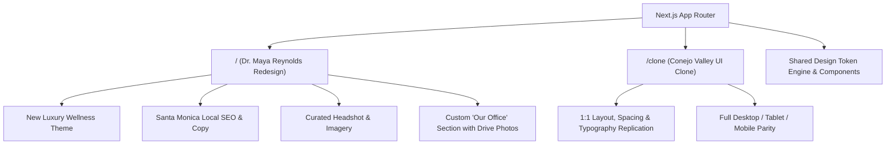

# Stage 2 Internship Assignment: Master Execution & Implementation Plan

> **Client / Organization**: Grow My Therapy  
> **Role**: Front-End Developer Intern  
> **Objective**: 1:1 UI Clone of Conejo Valley Counseling + Creative Redesign for Dr. Maya Reynolds, PsyD + Custom "Our Office" Section + Video Walkthrough  
> **Evaluation Breakdown**: UI Cloning (25%) | Theme & Design (25%) | Copywriting & Images (10%) | Custom Section (10%) | Video Demo (30%)  
> **Required Stack**: Next.js (App Router) + Tailwind CSS + TypeScript

---

## 1. Project Overview & Strategy

The assignment consists of four interrelated parts, each testing a distinct facet of real-world agency work for mental health practitioners. To maximize score and demonstrate senior-level craftsmanship, we will implement an **Interactive Dual-Mode Web Application**:

1. **Redesign Route (`/`)**: Complete creative redesign featuring Dr. Maya Reynolds, PsyD (Santa Monica, CA), new luxury wellness theme, bespoke copy, curated imagery, and the new "Our Office" section.
2. **Clone Route (`/clone`)**: 1:1 pixel-accurate clone of the original [Conejo Valley Counseling](https://www.conejovalleycounseling.com/home) homepage for direct side-by-side evaluation.
3. **Global Mode Switcher**: A sleek, non-intrusive floating toggle in the header/bottom bar allowing the evaluator to instantly compare the original clone with the redesigned therapist website.

---

## 2. Source Documents & Asset Reference

| Material | URL / Reference | Critical Extracted Data |
|---|---|---|
| **Target Site** | [conejovalleycounseling.com/home](https://www.conejovalleycounseling.com/home) | 11 sections: Header, Hero, Empathy, Who We Help, Quote, Specialties Tags, How We Work, Divider, Detailed Specialties, CTA, Footer |
| **Therapist Profile** | [Dr. Maya Reynolds Google Doc](https://docs.google.com/document/d/1-IJVKEjuqV9CTd9QH16UNHJ7SQfdiweS4oAIZ8vmgHU/edit?usp=sharing) | Licensed Clinical Psychologist, Santa Monica, CA (`123th Street 45 W, Santa Monica, CA 90401`). Focus: Anxiety, trauma, panic, burnout, perfectionism in high-achieving adults. Modalities: CBT, EMDR, Mindfulness, Somatic work |
| **Official Drive Assets** | [Google Drive Folder](https://drive.google.com/drive/folders/1fbAMSdqGF_ltNc0JiltkpIr_C26kRvLs) | `Dr. Maya Reynolds.png` (Headshot), `office1.jpeg` (Office interior), `office2.jpeg` (Office seating & natural light) |

---

## 3. Brand Identity & Design System

### A. Color Palette Matrix

To depart from the original dark-teal/olive tones while creating a warm, clinical, and calming atmosphere tailored to Santa Monica:

| Role | Color Name | Hex Code | Tailwind Token | Application |
|---|---|---|---|---|
| **Primary Base** | Coastal Alabaster | `#FAF8F5` | `bg-sand-50` | Primary site background, clean breathing space |
| **Secondary Surface**| Warm Oatmeal Linen | `#F0ECE1` | `bg-sand-100` | Section cards, alternating section bands |
| **Primary Dark** | Deep Evergreen Slate | `#233329` | `text-forest-900` | Headings, primary CTA buttons, footer |
| **Secondary Accent** | Terracotta Clay | `#C1684B` | `accent-clay` | Italic emphasis, active badges, highlights |
| **Muted Accent** | Sage Mist | `#8EA695` | `accent-sage` | Borders, subtle badges, icon accents |
| **Text Primary** | Deep Charcoal Ink | `#1B241E` | `text-ink-900` | Body copy, navigation links |
| **Text Muted** | Warm Stone | `#5A655E` | `text-ink-600` | Secondary descriptions, subtexts |

### B. Typography Hierarchy
- **Serif / Display (Headings)**: `Playfair Display` or `Cormorant Garamond` (editorial, comforting, elevated therapy feel).
- **Sans-Serif (Body & UI)**: `Plus Jakarta Sans` or `Inter` (crisp legibility across all screen sizes).

---

## 4. Section-by-Section Mapping & Content Transformation

| Section # | Original Clone ([/clone](/clone)) | Redesign ([/](file:///)) for Dr. Maya Reynolds |
|:---:|---|---|
| **1. Header** | Conejo Valley Family Counseling Logo, Nav (About, Our Team, Specialties, Methods, FAQs, Contact CTA) | Dr. Maya Reynolds, PsyD Branding, Nav (About, Specialties, Approach, Our Office, FAQs, Book Consultation CTA) |
| **2. Hero** | *"ONLINE & IN-PERSON COUNSELING IN NEWBURY PARK & ACROSS CA"* H1: *"Rebuild your foundation on solid ground and finally begin to thrive."* | *"IN-PERSON IN SANTA MONICA & TELEHEALTH ACROSS CALIFORNIA"* H1: *"Find grounded calm beyond anxiety, trauma, and burnout."* |
| **3. Empathy Block** | *"You're holding onto hope that life can be better than it is right now..."* | *"High-achieving on the outside, but quietly overwhelmed within?"* (Addresses the high internal pressure, overthinking, and nervous system tension) |
| **4. Who We Help** | 3 Cards: Adults, Couples, Children & Teens | 3 Focused Cards: High-Achieving Professionals & Creatives, Trauma & Panic Sufferers, Perfectionism & Chronic Stress |
| **5. Quote Banner** | *"You deserve a place where your story is heard, valued, and understood..."* | *"Therapy is a collaborative space to slow down, reconnect, and heal at the root—both emotionally and physiologically."* |
| **6. Specialties Cloud** | 12 tags (Dissociation, Trauma, Family conflict, Marriage...) | 12 curated tags (Anxiety Disorders, Panic Recovery, EMDR Therapy, Complex Trauma, Somatic Regulation, Executive Burnout, Perfectionism, Mindfulness-Based CBT, Chronic Stress, Boundary Setting, Self-Esteem, Nervous System Balance) |
| **7. How We Work / Bio** | Team philosophy on personalized therapy | **Meet Dr. Maya Reynolds, PsyD**: Clinical psychologist bio with genuine headshot photo, warm collaborative philosophy, and integrative science-backed methodology |
| **8. Typographic Break** | *"Honoring where you've been & helping shape where you're headed."* | *"Bridging evidence-based science with compassionate, depth-oriented care."* |
| **9. Core Services Grid** | 4 Cards: Trauma, Dissociation, EMDR, Special Needs Parenting | 3 In-Depth Specialty Cards: 1. **Anxiety & Panic Recovery** (CBT + Somatic) 2. **Trauma & EMDR Therapy** (Targeted, paced stabilization) 3. **Burnout & Perfectionism Counseling** (Sustainable living & working) |
| **10. NEW CUSTOM SECTION** | *(Does not exist in original template)* | **"Our Office: A Calm Space for Healing in Santa Monica"** Details the private, sunlit sanctuary at 123th Street 45 W, Santa Monica, CA 90401 with `office1.jpeg` and `office2.jpeg` gallery |
| **11. FAQ Accordion** | Brief template FAQs | Interactive FAQs tailored to Dr. Maya's practice (In-person vs. Telehealth, EMDR details, Rates/Insurance, First session expectations) |
| **12. Booking CTA** | *"Find a therapist who is the right fit for you"* | *"Begin Your Healing Journey Today"* with direct consultation scheduling CTA |
| **13. Footer** | Newbury Park address, service areas, team roster | Santa Monica address, California telehealth coverage, hours, contact details, legal links |

---

## 5. Detailed Step-by-Step Execution Roadmap

### Phase 1: Environment & Project Foundation
- [ ] Initialize Next.js 14+ App Router project with TypeScript and Tailwind CSS.
- [ ] Install essential utility packages: `lucide-react`, `clsx`, `tailwind-merge`.
- [ ] Configure Tailwind CSS with custom font imports and the brand design tokens (colors, typography, container widths).
- [ ] Ingest Dr. Maya Reynolds' assets from Drive (`Dr. Maya Reynolds.png`, `office1.jpeg`, `office2.jpeg`) into `/public/images/`.
- [ ] Source and curate high-resolution complementary photography (calming California coastal nature, warm architectural interiors).

### Phase 2: Building the UI Clone Core (`/clone`)
- [ ] Construct the 1:1 responsive Navigation Bar with desktop dropdown menus and mobile sliding drawer.
- [ ] Build the 1:1 Hero Section matching Conejo Valley Counseling's typography, button styles, and layout.
- [ ] Implement the Empathy Block and 3-Card "Who We Help" Grid.
- [ ] Implement the Quote Banner and Tag Cloud.
- [ ] Implement the "How We Work" 2-Column Section.
- [ ] Replicate the 4-Card Specialty Grid with hover interactions.
- [ ] Replicate the final Scheduling CTA and full 4-column Footer.
- [ ] Audit tablet and mobile viewports against the live template.

### Phase 3: Building the Dr. Maya Reynolds Redesign (`/`)
- [ ] Implement the new luxury wellness theme (Alabaster / Warm Linen / Evergreen / Clay).
- [ ] Apply Dr. Maya Reynolds' full copywriting across all headings, body texts, and badges.
- [ ] Integrate Dr. Maya Reynolds' official portrait into the About / Bio section.
- [ ] Format the 3 core clinical services with targeted Santa Monica SEO keywords.
- [ ] Embed the interactive FAQ accordion section.
- [ ] Add the floating mode switcher (`Clone View` ↔ `Redesign View`).

### Phase 4: Developing the Custom "Our Office" Section
- [ ] Create the section layout highlighting the Santa Monica office ambiance.
- [ ] Integrate `office1.jpeg` and `office2.jpeg` with high-resolution lightbox or interactive modal zoom.
- [ ] Detail physical address (`123th Street 45 W, Santa Monica, CA 90401`), parking/accessibility notes, and in-person vs. virtual hybrid options.
- [ ] Ensure seamless styling consistency with typography, spacing, and button aesthetics.

### Phase 5: SEO, Performance & Accessibility Polish
- [ ] Configure Next.js Metadata API (Title tags, meta descriptions, Open Graph preview cards, canonical tags).
- [ ] Add JSON-LD Structured Data (`Psychologist` / `LocalBusiness` schema for Santa Monica).
- [ ] Verify semantic heading hierarchy (`h1` -> `h2` -> `h3`).
- [ ] Test keyboard navigation, focus outlines, and WCAG AA color contrast.
- [ ] Optimize images with `next/image` (WebP/AVIF compression, responsive `sizes`, LCP priority loading).

### Phase 6: Production Build & Vercel Deployment
- [ ] Run type-checking (`tsc --noEmit`) and ESLint validation.
- [ ] Execute production build (`npm run build`) to ensure zero errors.
- [ ] Initialize Git repository with clear, professional commit history.
- [ ] Deploy to Vercel / Netlify and verify live site functionality.

### Phase 7: Video Walkthrough Preparation & Recording Guide
- [ ] Prepare a 5-minute timed client presentation script simulating a professional agency walk-through for Dr. Maya Reynolds.
- [ ] Record high-definition walkthrough covering desktop view, responsive mobile view, design rationale, and office highlights.

---

## 6. Video Walkthrough Script (5-Minute Client Demo)

| Timestamp | Phase | Key Talking Points |
|---|---|---|
| **0:00 – 0:45** | **Warm Welcome & Vision** | *"Hello Dr. Reynolds! We’re thrilled to present the first draft of your new practice website. Our core goal was to create a digital extension of your Santa Monica practice: calming, grounded, and modern."* |
| **0:45 – 1:45** | **Hero & First Impression** | Walk through the warm alabaster and evergreen palette. Highlight the H1 copy targeting high-achieving adults and how it establishes immediate psychological safety and authority. |
| **1:45 – 2:45** | **Services & Clinical Approach** | Show the 3 distinct service offerings (Anxiety & Panic, Trauma/EMDR, Burnout). Explain how non-clinical language helps hesitant clients feel understood. Show Maya's bio integration. |
| **2:45 – 3:30** | **The Custom 'Our Office' Showcase** | Demo the physical Santa Monica office section featuring her actual office photos. Explain why showcasing a serene space reduces friction for in-person clients. |
| **3:30 – 4:15** | **Mobile Responsiveness Demo** | Switch to mobile viewport in DevTools. Demonstrate sticky navigation, thumb-friendly tap targets, readable typography, and effortless consultation booking. |
| **4:15 – 5:00** | **Local SEO, Conversion & Next Steps** | Summarize local Santa Monica search optimization, how the clear CTAs guide visitors into booked consultations, and invite her feedback for final polish. |

---

## 7. Submission Checklist

- [ ] Live website deployed and accessible on Vercel
- [ ] Public GitHub repository with clean README and installation instructions
- [ ] 5-minute Loom video link recorded in clear, confident, jargon-free English
- [ ] Submitted on Internshala well within the 6-day window
