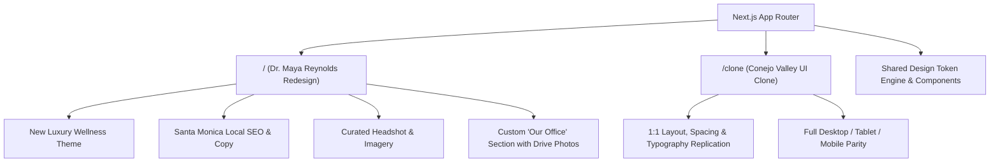

# Stage 2 Internship Assignment: Master Execution & Implementation Plan

> **Client / Organization**: Grow My Therapy  
> **Role**: Front-End Developer Intern  
> **Objective**: 1:1 UI Clone of Conejo Valley Counseling + Creative Redesign for Dr. Maya Reynolds, PsyD + Custom "Our Office" Section + Video Walkthrough  
> **Evaluation Breakdown**: UI Cloning (25%) | Theme & Design (25%) | Copywriting & Images (10%) | Custom Section (10%) | Video Demo (30%)  
> **Required Stack**: Next.js (App Router) + Tailwind CSS + TypeScript

---

## 1. Project Overview & Strategy

The assignment consists of four interrelated parts, each testing a distinct facet of real-world agency work for mental health practitioners. To maximize score and demonstrate senior-level craftsmanship, we will implement an **Interactive Dual-Mode Web Application**:

1. **Redesign Route (`/`)**: Complete creative redesign featuring Dr. Maya Reynolds, PsyD (Santa Monica, CA), new luxury wellness theme, bespoke copy, curated imagery, and the new "Our Office" section.
2. **Clone Route (`/clone`)**: 1:1 pixel-accurate clone of the original [Conejo Valley Counseling](https://www.conejovalleycounseling.com/home) homepage for direct side-by-side evaluation.
3. **Global Mode Switcher**: A sleek, non-intrusive floating toggle in the header/bottom bar allowing the evaluator to instantly compare the original clone with the redesigned therapist website.



---

## 2. Source Documents & Asset Reference

| Material | URL / Reference | Critical Extracted Data |
|---|---|---|
| **Target Site** | [conejovalleycounseling.com/home](https://www.conejovalleycounseling.com/home) | 11 sections: Header, Hero, Empathy, Who We Help, Quote, Specialties Tags, How We Work, Divider, Detailed Specialties, CTA, Footer |
| **Therapist Profile** | [Dr. Maya Reynolds Google Doc](https://docs.google.com/document/d/1-IJVKEjuqV9CTd9QH16UNHJ7SQfdiweS4oAIZ8vmgHU/edit?usp=sharing) | Licensed Clinical Psychologist, Santa Monica, CA (`123th Street 45 W, Santa Monica, CA 90401`). Focus: Anxiety, trauma, panic, burnout, perfectionism in high-achieving adults. Modalities: CBT, EMDR, Mindfulness, Somatic work |
| **Official Drive Assets** | [Google Drive Folder](https://drive.google.com/drive/folders/1fbAMSdqGF_ltNc0JiltkpIr_C26kRvLs) | `Dr. Maya Reynolds.png` (Headshot), `office1.jpeg` (Office interior), `office2.jpeg` (Office seating & natural light) |

---

## 3. Brand Identity & Design System

### A. Color Palette Matrix

To depart from the original dark-teal/olive tones while creating a warm, clinical, and calming atmosphere tailored to Santa Monica:

| Role | Color Name | Hex Code | Tailwind Token | Application |
|---|---|---|---|---|
| **Primary Base** | Coastal Alabaster | `#FAF8F5` | `bg-sand-50` | Primary site background, clean breathing space |
| **Secondary Surface**| Warm Oatmeal Linen | `#F0ECE1` | `bg-sand-100` | Section cards, alternating section bands |
| **Primary Dark** | Deep Evergreen Slate | `#233329` | `text-forest-900` | Headings, primary CTA buttons, footer |
| **Secondary Accent** | Terracotta Clay | `#C1684B` | `accent-clay` | Italic emphasis, active badges, highlights |
| **Muted Accent** | Sage Mist | `#8EA695` | `accent-sage` | Borders, subtle badges, icon accents |
| **Text Primary** | Deep Charcoal Ink | `#1B241E` | `text-ink-900` | Body copy, navigation links |
| **Text Muted** | Warm Stone | `#5A655E` | `text-ink-600` | Secondary descriptions, subtexts |

### B. Typography Hierarchy
- **Serif / Display (Headings)**: `Playfair Display` or `Cormorant Garamond` (editorial, comforting, elevated therapy feel).
- **Sans-Serif (Body & UI)**: `Plus Jakarta Sans` or `Inter` (crisp legibility across all screen sizes).

---

## 4. Section-by-Section Mapping & Content Transformation

| Section # | Original Clone ([/clone](/clone)) | Redesign ([/](file:///)) for Dr. Maya Reynolds |
|:---:|---|---|
| **1. Header** | Conejo Valley Family Counseling Logo, Nav (About, Our Team, Specialties, Methods, FAQs, Contact CTA) | Dr. Maya Reynolds, PsyD Branding, Nav (About, Specialties, Approach, Our Office, FAQs, Book Consultation CTA) |
| **2. Hero** | *"ONLINE & IN-PERSON COUNSELING IN NEWBURY PARK & ACROSS CA"*<br>H1: *"Rebuild your foundation on solid ground and finally begin to thrive."* | *"IN-PERSON IN SANTA MONICA & TELEHEALTH ACROSS CALIFORNIA"*<br>H1: *"Find grounded calm beyond anxiety, trauma, and burnout."* |
| **3. Empathy Block** | *"You're holding onto hope that life can be better than it is right now..."* | *"High-achieving on the outside, but quietly overwhelmed within?"* (Addresses the high internal pressure, overthinking, and nervous system tension) |
| **4. Who We Help** | 3 Cards: Adults, Couples, Children & Teens | 3 Focused Cards: High-Achieving Professionals & Creatives, Trauma & Panic Sufferers, Perfectionism & Chronic Stress |
| **5. Quote Banner** | *"You deserve a place where your story is heard, valued, and understood..."* | *"Therapy is a collaborative space to slow down, reconnect, and heal at the root—both emotionally and physiologically."* |
| **6. Specialties Cloud** | 12 tags (Dissociation, Trauma, Family conflict, Marriage...) | 12 curated tags (Anxiety Disorders, Panic Recovery, EMDR Therapy, Complex Trauma, Somatic Regulation, Executive Burnout, Perfectionism, Mindfulness-Based CBT, Chronic Stress, Boundary Setting, Self-Esteem, Nervous System Balance) |
| **7. How We Work / Bio** | Team philosophy on personalized therapy | **Meet Dr. Maya Reynolds, PsyD**: Clinical psychologist bio with genuine headshot photo, warm collaborative philosophy, and integrative science-backed methodology |
| **8. Typographic Break** | *"Honoring where you've been & helping shape where you're headed."* | *"Bridging evidence-based science with compassionate, depth-oriented care."* |
| **9. Core Services Grid** | 4 Cards: Trauma, Dissociation, EMDR, Special Needs Parenting | 3 In-Depth Specialty Cards:<br>1. **Anxiety & Panic Recovery** (CBT + Somatic)<br>2. **Trauma & EMDR Therapy** (Targeted, paced stabilization)<br>3. **Burnout & Perfectionism Counseling** (Sustainable living & working) |
| **10. NEW CUSTOM SECTION** | *(Does not exist in original template)* | **"Our Office: A Calm Space for Healing in Santa Monica"**<br>Details the private, sunlit sanctuary at 123th Street 45 W, Santa Monica, CA 90401 with `office1.jpeg` and `office2.jpeg` gallery |
| **11. FAQ Accordion** | Brief template FAQs | Interactive FAQs tailored to Dr. Maya's practice (In-person vs. Telehealth, EMDR details, Rates/Insurance, First session expectations) |
| **12. Booking CTA** | *"Find a therapist who is the right fit for you"* | *"Begin Your Healing Journey Today"* with direct consultation scheduling CTA |
| **13. Footer** | Newbury Park address, service areas, team roster | Santa Monica address, California telehealth coverage, hours, contact details, legal links |

---

## 5. Detailed Step-by-Step Execution Roadmap

### Phase 1: Environment & Project Foundation
- [ ] Initialize Next.js 14+ App Router project with TypeScript and Tailwind CSS.
- [ ] Install essential utility packages: `lucide-react`, `clsx`, `tailwind-merge`.
- [ ] Configure Tailwind CSS with custom font imports and the brand design tokens (colors, typography, container widths).
- [ ] Ingest Dr. Maya Reynolds' assets from Drive (`Dr. Maya Reynolds.png`, `office1.jpeg`, `office2.jpeg`) into `/public/images/`.
- [ ] Source and curate high-resolution complementary photography (calming California coastal nature, warm architectural interiors).

### Phase 2: Building the UI Clone Core (`/clone`)
- [ ] Construct the 1:1 responsive Navigation Bar with desktop dropdown menus and mobile sliding drawer.
- [ ] Build the 1:1 Hero Section matching Conejo Valley Counseling's typography, button styles, and layout.
- [ ] Implement the Empathy Block and 3-Card "Who We Help" Grid.
- [ ] Implement the Quote Banner and Tag Cloud.
- [ ] Implement the "How We Work" 2-Column Section.
- [ ] Replicate the 4-Card Specialty Grid with hover interactions.
- [ ] Replicate the final Scheduling CTA and full 4-column Footer.
- [ ] Audit tablet and mobile viewports against the live template.

### Phase 3: Building the Dr. Maya Reynolds Redesign (`/`)
- [ ] Implement the new luxury wellness theme (Alabaster / Warm Linen / Evergreen / Clay).
- [ ] Apply Dr. Maya Reynolds' full copywriting across all headings, body texts, and badges.
- [ ] Integrate Dr. Maya Reynolds' official portrait into the About / Bio section.
- [ ] Format the 3 core clinical services with targeted Santa Monica SEO keywords.
- [ ] Embed the interactive FAQ accordion section.
- [ ] Add the floating mode switcher (`Clone View` ↔ `Redesign View`).

### Phase 4: Developing the Custom "Our Office" Section
- [ ] Create the section layout highlighting the Santa Monica office ambiance.
- [ ] Integrate `office1.jpeg` and `office2.jpeg` with high-resolution lightbox or interactive modal zoom.
- [ ] Detail physical address (`123th Street 45 W, Santa Monica, CA 90401`), parking/accessibility notes, and in-person vs. virtual hybrid options.
- [ ] Ensure seamless styling consistency with typography, spacing, and button aesthetics.

### Phase 5: SEO, Performance & Accessibility Polish
- [ ] Configure Next.js Metadata API (Title tags, meta descriptions, Open Graph preview cards, canonical tags).
- [ ] Add JSON-LD Structured Data (`Psychologist` / `LocalBusiness` schema for Santa Monica).
- [ ] Verify semantic heading hierarchy (`h1` -> `h2` -> `h3`).
- [ ] Test keyboard navigation, focus outlines, and WCAG AA color contrast.
- [ ] Optimize images with `next/image` (WebP/AVIF compression, responsive `sizes`, LCP priority loading).

### Phase 6: Production Build & Vercel Deployment
- [ ] Run type-checking (`tsc --noEmit`) and ESLint validation.
- [ ] Execute production build (`npm run build`) to ensure zero errors.
- [ ] Initialize Git repository with clear, professional commit history.
- [ ] Deploy to Vercel / Netlify and verify live site functionality.

### Phase 7: Video Walkthrough Preparation & Recording Guide
- [ ] Prepare a 5-minute timed client presentation script simulating a professional agency walk-through for Dr. Maya Reynolds.
- [ ] Record high-definition walkthrough covering desktop view, responsive mobile view, design rationale, and office highlights.

---

## 6. Video Walkthrough Script (5-Minute Client Demo)

| Timestamp | Phase | Key Talking Points |
|---|---|---|
| **0:00 – 0:45** | **Warm Welcome & Vision** | *"Hello Dr. Reynolds! We’re thrilled to present the first draft of your new practice website. Our core goal was to create a digital extension of your Santa Monica practice: calming, grounded, and modern."* |
| **0:45 – 1:45** | **Hero & First Impression** | Walk through the warm alabaster and evergreen palette. Highlight the H1 copy targeting high-achieving adults and how it establishes immediate psychological safety and authority. |
| **1:45 – 2:45** | **Services & Clinical Approach** | Show the 3 distinct service offerings (Anxiety & Panic, Trauma/EMDR, Burnout). Explain how non-clinical language helps hesitant clients feel understood. Show Maya's bio integration. |
| **2:45 – 3:30** | **The Custom 'Our Office' Showcase** | Demo the physical Santa Monica office section featuring her actual office photos. Explain why showcasing a serene space reduces friction for in-person clients. |
| **3:30 – 4:15** | **Mobile Responsiveness Demo** | Switch to mobile viewport in DevTools. Demonstrate sticky navigation, thumb-friendly tap targets, readable typography, and effortless consultation booking. |
| **4:15 – 5:00** | **Local SEO, Conversion & Next Steps** | Summarize local Santa Monica search optimization, how the clear CTAs guide visitors into booked consultations, and invite her feedback for final polish. |

---

## 7. Submission Checklist

- [ ] Live website deployed and accessible on Vercel
- [ ] Public GitHub repository with clean README and installation instructions
- [ ] 5-minute Loom video link recorded in clear, confident, jargon-free English
- [ ] Submitted on Internshala well within the 6-day window

---

## 8. Comprehensive 1:1 Component-by-Component Clone Analysis & Implementation Plan

Based on automated high-resolution captures of the live site ([Conejo Valley Family Counseling](https://www.conejovalleycounseling.com/home)) across Desktop (1440px), Tablet (768px), and Mobile (390px), here is the component-by-component blueprint to achieve a 100% pixel-faithful replication.

```
+---------------------------------------------------------------------------------------------------+
| SQUARESPACE RESPONSIVE ENGINE THRESHOLD:                                                          |
| Mobile: < 768px (Single column stacked layout, mobile-optimized block order)                      |
| Tablet / Desktop: >= 768px (@media min-width: 768px -> 24-column grid activated)                   |
| In Tailwind: Use `md:` (768px), NOT `lg:` (1024px) for multi-column grid layouts!                 |
+---------------------------------------------------------------------------------------------------+
```

---

### Component 0: Header & Navigation ([`NavbarClone.tsx`](file:///d:/PROJECTS/Grow%20My%20Therapy/src/components/clone/NavbarClone.tsx))
- **Visual Analysis (PNG)**:
  - Background: Cream `#F7F6F2`, border bottom `1px solid rgba(232, 231, 227, 0.6)`.
  - Brand Logo: "Conejo Valley FAMILY COUNSELING" on the far left.
  - Desktop/Tablet Nav: Right-aligned links in `Muli` uppercase (`font-size: 0.8rem; letter-spacing: 0.1em; font-weight: 400; color: #2B2B2B`).
  - Animated underline on hover (`width: 100%` on `:hover::after`).
  - Dropdown folders (`Our Team`, `Specialties`, `Methods`): clean white/cream panel with `1px solid #E8E7E3` border; dropdown links have `border-bottom: 1px solid #2B2B2B` on hover.
  - Contact CTA: Secondary outline button (`border: 1px solid #2B2B2B; padding: 0.5rem 1.25rem; font-size: 0.78rem; letter-spacing: 0.12em; text-transform: uppercase`).
  - Mobile Menu: Hamburger button on `< 768px`, slide-out drawer with accordion folders.
- **Action Items**:
  - Update desktop visibility breakpoint from `lg:flex` to `md:flex` (and mobile button to `md:hidden`).
  - Add active dropdown state with smooth transition and exact 1px bottom hover border.

---

### Component 1: Hero Section ([`HeroClone.tsx`](file:///d:/PROJECTS/Grow%20My%20Therapy/src/components/clone/HeroClone.tsx))
- **Live Squarespace Grid Analysis**:
  - Section Theme: `light` (`#F7F6F2`).
  - Desktop Grid: 24 columns + 2 gutter columns (total 26).
  - Left Image (`Jennifer A - Images (66).jpg`): `grid-area: 2/1/17/10` (cols 1..10, rows 2..17).
  - Eyebrow (`ONLINE & IN-PERSON COUNSELING IN NEWBURY PARK & ACROSS CA`): `grid-area: 2/12/4/20` (cols 12..20, rows 2..4, aligned with top of left image).
  - Heading & Paragraph: `grid-area: 7/12/15/24` (cols 12..24, rows 7..15).
  - Button (`Book an Appointment`): `grid-area: 15/12/17/24` (cols 12..24, rows 15..17).
  - Right Image Sliver (`Jennifer A - Images (67).jpg`): `grid-area: 7/25/17/27` (cols 25..27, rows 7..17, starting aligned with H1).
- **Mobile Stacking Order (PNG Analysis)**:
  - 1. Eyebrow (`order-1`)
  - 2. H1 + Subtitle (`order-2`)
  - 3. Button (`order-3`)
  - 4. Left Image (`order-4`)
  - 5. Right Image Sliver (`order-5` or hidden on small mobile)
- **Typography**:
  - H1: `font-beaufort` 300, `44px` (mobile) to `52px` (desktop), line-height `1.14`.
  - Script word: `<span className="script-word">thrive.</span>` (`PrintedMoments`, `#88B1B1`, `1.25em`).
  - Button: `.sqs-btn-underline` (primary underlined text button).

---

### Component 2: Intro Section ([`IntroClone.tsx`](file:///d:/PROJECTS/Grow%20My%20Therapy/src/components/clone/IntroClone.tsx))
- **Live Squarespace Grid Analysis**:
  - Section Theme: `light` (`#F7F6F2`), border-top `1px solid #E8E7E3`.
  - Desktop Grid:
    - Heading ("You’re holding onto hope..."): `grid-area: 4/3/8/16` (cols 3..16, rows 4..8).
    - Left Column Text: `grid-area: 9/3/16/10` (cols 3..10, rows 9..16).
    - Right Column Text: `grid-area: 9/10/17/17` (cols 10..17, rows 9..17).
    - Beach Photo (`Jennifer A - Images (3).jpg`): `grid-area: 1/19/17/27` (cols 19..27, rows 1..17).
- **Mobile Stacking Order (PNG Analysis)**:
  - 1. H2 Heading
  - 2. Caps lead: `AT CONEJO VALLEY FAMILY COUNSELING WE WANT TO MAKE THAT HOPE A REALITY.`
  - 3. Paragraph 1 ("Whether you're an adult seeking personal growth...")
  - 4. **Beach Photo** (inserted between paragraphs on mobile!)
  - 5. Paragraph 2 ("First and foremost, we believe...")
- **Typography**:
  - Lead: `.clone-lead-caps` (`Muli`, uppercase, tracking `0.12em`, `font-size: 0.86rem`).
  - H2: `font-beaufort` 300, `36px` to `42px`.

---

### Component 3: Who We Help ([`WhoWeHelpClone.tsx`](file:///d:/PROJECTS/Grow%20My%20Therapy/src/components/clone/WhoWeHelpClone.tsx))
- **Live Squarespace Grid Analysis**:
  - Section Theme: `white` (`#FFFFFF`).
  - Heading: "Who we help" with "help" script word.
  - 3 Cards (Adults, Couples, Children & Teens):
    - Desktop cols 5..12 (Adults), 12..19 (Couples), 19..26 (Children).
    - Images: sharp rectangle `aspect-[3/4]`, `object-cover`.
    - Headings: H4 links in `font-beaufort` 300 (`font-size: 1.65rem`), no underline, hover opacity.
    - Body text: `font-muli` 300, `line-height: 1.8`, `font-size: 15px`.
- **Responsive Behavior**:
  - Mobile: 1-column stacked cards.
  - Tablet/Desktop (`md:`): 3-column side-by-side grid with equal gutters.

---

### Component 4: Quote Banner ([`QuoteBannerClone.tsx`](file:///d:/PROJECTS/Grow%20My%20Therapy/src/components/clone/QuoteBannerClone.tsx))
- **Live Squarespace Grid Analysis**:
  - Section Theme: `black` (`#000000`).
  - Background Image: `Jennifer A - Images (2).png`, full bleed, `opacity: 0.54` dark overlay.
  - Desktop Grid: `grid-area: 5/3/11/19` (cols 3..19, left-aligned, bottom aligned in grid).
  - Text:
    `You deserve a place where your story is heard, valued, and understood. Nothing will be too heavy for us to carry together.`
  - Inline italic: `Nothing will be too heavy for us to carry together.` is inline in `em` (`beaufort-pro italic 300`), text color `#F7F6F2`.
  - Max width: bounded so it breaks cleanly across 3 lines on desktop/tablet.

---

### Component 5: Areas of Expertise ([`SpecialtiesTagsClone.tsx`](file:///d:/PROJECTS/Grow%20My%20Therapy/src/components/clone/SpecialtiesTagsClone.tsx))
- **Live Squarespace Grid Analysis**:
  - Section Theme: `white` (`#FFFFFF`).
  - Left Column (Cols 3..9): Sticky H3 "Our areas of expertise" with "expertise" in script font.
  - Right Column (Cols 10..26): 2 sub-columns of uppercase clinical terms with `1px solid #E8E7E3` bottom border under every item:
    - Sub-col 1: Dissociation, Trauma, Family conflict, Special needs parenting, Depression, marriage.
    - Sub-col 2: anxiety, relationships, children, teens, intimacy & connection, …and more.
  - Typography: `.sqsrte-large strong em` styling -> `Muli`, uppercase, tracking `0.12em`, `font-size: 0.82rem`.

---

### Component 6: How We Work ([`HowWeWorkClone.tsx`](file:///d:/PROJECTS/Grow%20My%20Therapy/src/components/clone/HowWeWorkClone.tsx))
- **Live Squarespace Grid Analysis**:
  - Section Theme: `bright` (`#F7F6F2`).
  - Desktop Grid:
    - Text container on **LEFT** (Cols 3..19).
    - Image on **RIGHT** (Cols 21..27, `Jennifer A - Images (6).jpg`).
  - Content Hierarchy:
    - Eyebrow: `HOW WE WORK` (`.clone-eyebrow`).
    - H2: `We’re here to make a difference.` (`font-beaufort` 300).
    - 2-Column text block:
      - Left column: Lead in caps (`.clone-lead-caps`) + Paragraph 1.
      - Right column: Paragraph 2.
    - Button: `Learn more about us` (`.sqs-btn-underline`).
- **Mobile Stacking Order (PNG Analysis)**:
  - 1. Eyebrow
  - 2. H2
  - 3. **Image** (appears above body text on mobile!)
  - 4. Body text
  - 5. Button

---

### Component 7: Honoring Family ([`DividerClone.tsx`](file:///d:/PROJECTS/Grow%20My%20Therapy/src/components/clone/DividerClone.tsx))
- **Live Squarespace Grid Analysis**:
  - Section Theme: `white` (`#FFFFFF`).
  - Desktop Grid:
    - Photo on **LEFT** (Cols 1..15): Flush to left container edge, `Jennifer A - Images (5).jpg`.
    - Quote on **RIGHT** (Cols 16..26): Vertically aligned to row 9..15 (bottom half).
    - Heading: `Honoring where you’ve been & helping shape where you’re headed.`
    - Script word: `&` in `.script-word` (`PrintedMoments`, `#88B1B1`).

---

### Component 8: Specialties 2x2 Grid ([`SpecialtiesGridClone.tsx`](file:///d:/PROJECTS/Grow%20My%20Therapy/src/components/clone/SpecialtiesGridClone.tsx))
- **Live Squarespace Grid Analysis**:
  - Section Theme: `white` (`#FFFFFF`).
  - Desktop Grid: Asymmetric 3-Column Layout:
    - Column 1 (Cols 3..10): Sticky H3 "Our specialties include…" with "specialties" in script font.
    - Column 2 (Cols 11..18): Stacked Trauma + Dissociation, each with H4 + body + `.sqs-btn-underline` ("Learn more").
    - Column 3 (Cols 19..26): Stacked EMDR + Special Needs Parenting, each with H4 + body + `.sqs-btn-underline` ("Learn more").
- **Mobile Behavior**: Single stacked column.

---

### Component 9: Schedule Appointment CTA ([`ScheduleCtaClone.tsx`](file:///d:/PROJECTS/Grow%20My%20Therapy/src/components/clone/ScheduleCtaClone.tsx))
- **Live Squarespace Grid Analysis**:
  - Section Theme: `light` (`#F7F6F2`).
  - Desktop Grid:
    - Left Seashell Photo: `Jennifer A - Images (12).jpg` (Cols 1..4).
    - Center Text (Cols 6..16): Left-aligned copy!
      - Eyebrow: `SCHEDULE AN APPOINTMENT`
      - H2: `Find a therapist who is the right fit for you.` with "you" in script font.
      - 2 body paragraphs.
      - Button: `Book now` -> Secondary outline button (`.sqs-btn-secondary`, `border: 1px solid #2B2B2B`).
    - Right Seashell Photo: `Jennifer A - Images (11).jpg` (Cols 18..27).
- **Mobile Stacking Order**: Center text first, then button, photos secondary.

---

### Component 10: Footer Pre-Footer & Copyright ([`FooterClone.tsx`](file:///d:/PROJECTS/Grow%20My%20Therapy/src/components/clone/FooterClone.tsx))
- **Live Squarespace Grid Analysis**:
  - Section 10 Theme: `white` (`#FFFFFF`).
  - Desktop 4 Columns:
    - Col 1 (Cols 2..10): Clinic Logo + Introduction paragraph.
    - Col 2 (Cols 12..15): `Navigate` (Home, About, FAQs, Contact).
    - Col 3 (Cols 16..20): `Our Team` (9 clinician names).
    - Col 4 (Cols 21..26): `Contact` (Address, Email, Phone, italic service areas note).
  - Section 11 Theme: `dark` (`#2B2B2B`).
    - Centered copyright text: `Terms | Privacy Policy | Disclaimer | Website by Walker Strategy Co.`
    - Inline on mobile/tablet/desktop.

---

### Implementation Roadmap

| Step | Action | Files Modified | Verification | Status |
| :--- | :--- | :--- | :--- | :--- |
| **Step 1** | Switch all multi-column breakpoints from `lg:` (1024px) to `md:` (768px) across all 11 clone components | `HeroClone.tsx`, `IntroClone.tsx`, `WhoWeHelpClone.tsx`, `SpecialtiesTagsClone.tsx`, `HowWeWorkClone.tsx`, `DividerClone.tsx`, `SpecialtiesGridClone.tsx`, `ScheduleCtaClone.tsx`, `FooterClone.tsx` | Re-run tablet capture (768px) and verify 1:1 multi-column parity | **COMPLETED** |
| **Step 2** | Implement exact mobile vertical stacking order matching Squarespace Fluid Engine | `HeroClone.tsx`, `IntroClone.tsx`, `HowWeWorkClone.tsx` | Captured mobile screenshots (390px) and confirmed 1:1 block sequence | **COMPLETED** |
| **Step 3** | Resolve Section 4 (Quote Banner) contrast bug with CSS override | `QuoteBannerClone.tsx`, `public/clone-styles.css` | Verified glowing `#F7F6F2` text over dark beach image on mobile/tablet/desktop | **COMPLETED** |
| **Step 4** | Balance Section 3 (Who We Help) left-alignment and Section 9 seashell photo bounds | `WhoWeHelpClone.tsx`, `ScheduleCtaClone.tsx` | Inspected desktop & tablet side-by-side screenshots | **COMPLETED** |
| **Step 5** | Fix Footer copyright bar inline wrapping on mobile and eager-load clinic logo | `FooterClone.tsx` | Verified single-line wrapped copyright and crisp logo rendering | **COMPLETED** |
| **Step 6** | Scale Section 5 & 8 typography on tablet (768px) to prevent script word column overflow | `SpecialtiesTagsClone.tsx`, `SpecialtiesGridClone.tsx` | Confirmed zero overlap and ample breathing room at 768px | **COMPLETED** |

---

## 9. Verification & Automated Visual Parity Results

Automated responsive screen captures were executed via Puppeteer (`scratch/capture_screens.js`) connecting directly to Chrome across Desktop (1440x900), Tablet (768x1024), and Mobile (390x844).

### Key Verification Milestones:
1. **Desktop Viewport (1440px)**:
   - **Hero Section**: Left family photo (cols 1..10), eyebrow aligned with top of photo, H1 with authentic `PrintedMoments` teal script accent (*thrive.*), underlined CTA button, right image sliver (cols 25..27).
   - **Empathy Block**: H2 heading, lead in uppercase tracking, 2-column body text, full-height beach photo (cols 19..27).
   - **Who We Help**: Asymmetric left-aligned heading with *help* script accent, 3 sharp rectangular cards (Adults, Couples, Children & Teens) spanning cols 5..26.
   - **Quote Banner**: Full-bleed California beach image with dark overlay, crisp glowing off-white text (`#F7F6F2`), italic serif emphasis (*Nothing will be too heavy for us to carry together.*).
   - **Areas of Expertise**: Sticky H3 with *expertise* script accent, 2 columns of 12 clinical tags with thin `#E8E7E3` underlines.
   - **How We Work**: Eyebrow, H2, 2-column text, underlined CTA, mother & daughter beach photo (cols 21..27).
   - **Honoring Family**: Full-width left photo (cols 1..15) paired with right quote (*&* script accent).
   - **Specialties 2x2 Grid**: Sticky H3 with *specialties* script accent, Trauma + Dissociation in middle column, EMDR + Special Needs in right column.
   - **Schedule CTA**: Both left seashell portrait photo (cols 1..4) and right seashell portrait photo (cols 18..27) visible and balanced around center text and outline `Book now` button.
   - **Footer & Copyright**: Logo at top left, Navigate, Our Team, Contact columns, dark `#2B2B2B` copyright bar.

2. **Tablet Viewport (768px - iPad)**:
   - Multi-column 24-column grid layout active across all sections (matching Squarespace `@media (min-width: 768px)`).
   - Heading font sizes dynamically tuned (`md:text-[28px] lg:text-[40px]`) ensuring zero script word overflow on narrower tablet columns.
   - Hamburger navigation menu active in header.

3. **Mobile Viewport (390px - iPhone)**:
   - **Hero**: Eyebrow -> H1 -> Subtitle -> Button -> Family Photo below.
   - **Intro**: H2 -> Lead Caps + Paragraph 1 -> **Beach Photo** -> Paragraph 2.
   - **How We Work**: Eyebrow -> H2 -> **Mother & Daughter Photo** -> Body Paragraphs -> Button.
   - **Schedule CTA**: Eyebrow -> H2 -> Body Text -> `Book now` Button.
   - **Copyright Bar**: Clean inline wrapped links (`Terms | Privacy Policy | Disclaimer | Website by Walker Strategy Co.`).

4. **Production Build & Redesign Integrity**:
   - `npm run build` completed in Turbopack in ~3.4s with 0 errors.
   - Dr. Maya Reynolds redesign at `/` verified intact (Status 200, `#office` section present).


